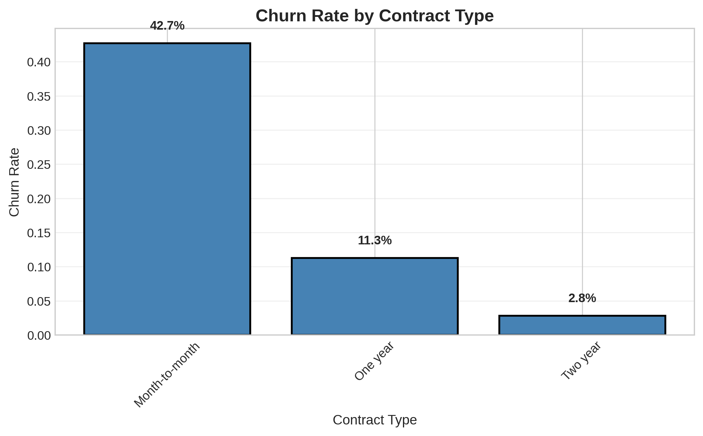
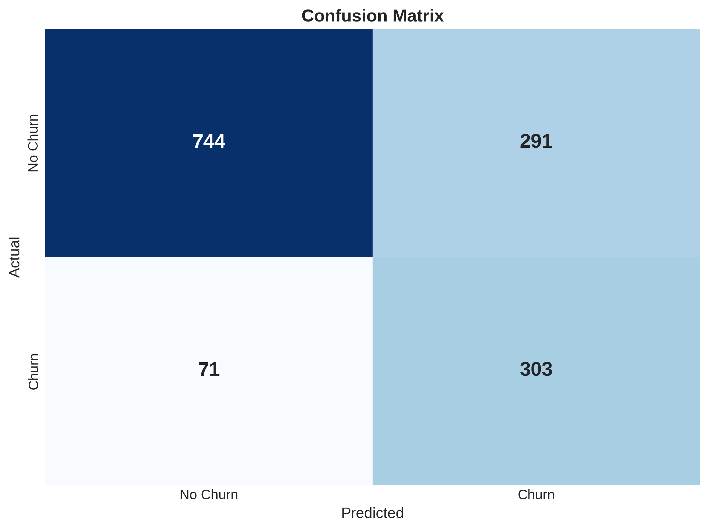
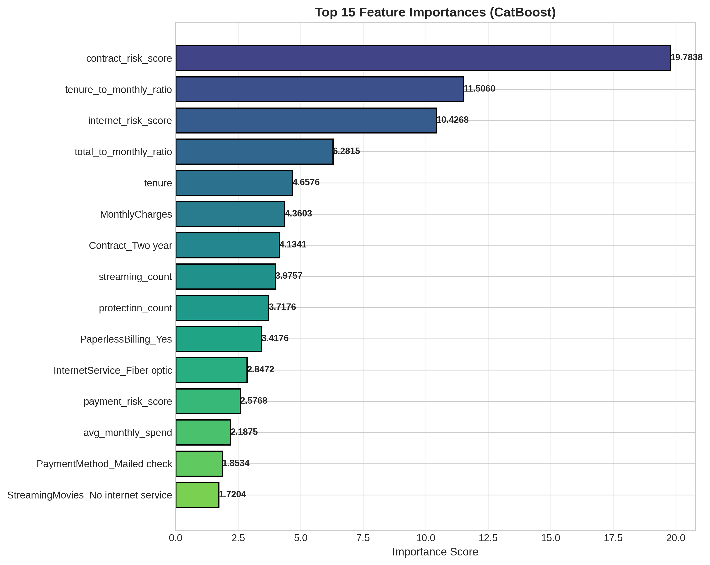

# Customer Churn Prediction

Predicting which telecom customers are likely to leave, so a company can reach out to them before they do. The project covers the full process, from cleaning and exploring the data to comparing three models, plus a small web app that gives a churn risk score for any customer.

**Result:** the final CatBoost model catches **81% of customers who are about to leave** (recall 0.81), with a ROC-AUC of **0.85**.

## The data

The [Telco Customer Churn dataset](https://www.kaggle.com/datasets/blastchar/telco-customer-churn): 7,043 customers with their account details, services and whether they left. About 27% of customers churned, so the classes are imbalanced.

## What the data shows

Three patterns stood out while exploring the data:

| Pattern | Churn rate |
| --- | --- |
| Month-to-month contract vs. two-year contract | 42.7% vs. 2.8% |
| Customers in their first year vs. after 4 years | 47.7% vs. 9.5% |
| Paying by electronic check vs. automatic credit card | 45.3% vs. 15.2% |



## Approach

1. **Clean the data.** `TotalCharges` was stored as text and had blanks for brand-new customers, so it was converted to a number and the blanks set to 0. The customer ID was dropped.
2. **Engineer features.** Nine new features were added based on the patterns above, including risk scores for contract type, payment method and internet service, the number of services a customer uses, and ratios such as tenure compared with monthly charges.
3. **Preprocess.** Numbers are scaled and categories are one-hot encoded inside a single scikit-learn `ColumnTransformer`, so the app can reuse exactly the same steps.
4. **Compare three models:** XGBoost, LightGBM and CatBoost, all evaluated on the same held-out 20% test set.
5. **Choose the best by F1-score**, which balances catching churners against raising false alarms.

## Results

| Model | ROC-AUC | F1-score | Precision | Recall |
| --- | --- | --- | --- | --- |
| XGBoost | 0.839 | 0.613 | 0.519 | 0.749 |
| LightGBM | 0.823 | 0.607 | 0.551 | 0.677 |
| **CatBoost** | **0.848** | **0.626** | **0.510** | **0.810** |

5-fold cross-validation gave a similar ROC-AUC (0.844 ± 0.011), so the results are stable rather than a lucky split.

On the test set, CatBoost correctly flagged 303 of the 374 customers who left and missed 71. For a churn problem, high recall matters most, because missing a customer who is about to leave costs more than offering a discount to one who would have stayed.



### What drives churn



Contract type is by far the strongest signal, followed by how long the customer has been with the company relative to what they pay, and the type of internet service. Several of the engineered features rank near the top.

## The app

`churn_prediction_app.py` is a Streamlit app. Enter a customer's details in the sidebar and it shows their churn probability and a low, medium or high risk level.

## Run it yourself

```bash
git clone https://github.com/jescaamondi/Churn_predictions.git
cd Churn_predictions
python -m venv venv
source venv/bin/activate        # on Windows: venv\Scripts\activate
pip install -r requirements.txt
cd Churn
```

Then either open the notebook:

```bash
jupyter notebook Churn.ipynb
```

or start the app:

```bash
streamlit run churn_prediction_app.py
```

## Tools

Python · pandas · scikit-learn · XGBoost · LightGBM · CatBoost · Matplotlib · seaborn · Streamlit
